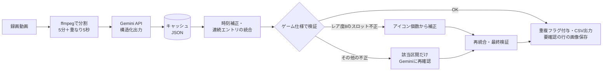

## 作ったもの

モンスターハンターワイルズの「護石」（ランダムにスキルとスロットが付く装備アイテム）を、**ゲーム画面の録画から読み取ってCSVにするツール**を作りました。

護石は大量に集まるのに、ゲーム内の並べ替え・絞り込みは機能が限られています。そこで「装備詳細」画面を1つずつ映した動画を Gemini API に渡し、1つの護石＝1行の CSV にして、スプレッドシートで自由に並べ替えられるようにしました。


- リポジトリ: https://github.com/oranegewimps/charm_extractor
- 技術: Python / google-genai（Gemini API）/ ffmpeg / Flask / unittest + GitHub Actions

実装は Claude Code と一緒に進めました。私が要件と仕様を書いて方針を承認し、実際の出力から誤読のパターンを見つけて対策を指示し、AI がコードとテストを書く、という分担です。この記事では、その中で効いた設計を中心に書きます。

## 全体の流れ



## 1. 動画は Files API でアップロードし、JSON スキーマで受け取る

動画は Files API でアップロードし、状態が `ACTIVE` になるまで待ってから解析します。サンプリングは1秒1フレームを基本にしています。出力は JSON スキーマ（構造化出力）で受け取ります。

```python
video_part = types.Part(
    file_data=types.FileData(file_uri=file.uri, mime_type=file.mime_type),
    video_metadata=types.VideoMetadata(fps=SAMPLING_FPS),
)
config = types.GenerateContentConfig(
    response_mime_type="application/json",
    response_json_schema=RESPONSE_SCHEMA,
)
response = client.models.generate_content(
    model=MODEL_NAME, contents=[video_part, PROMPT], config=config,
)
```

スキーマのポイントは2つあります。

- **数値の項目も文字列で受け取る**：「読めないものは推測せず `不明` と書く」というルールにしたので、レア度やスロットレベルも `"8"` や `"不明"` を入れられる文字列にしています。数値への正規化はコード側で行います。
- **途中経過も出させる**：スキル数（`skill_count`）、スロットアイコンの個数（`slot_icon_count`）、スロット判定の確信度（`slot_confidence`）も返させます。これがあとで検証と補正の材料になります。

## 2. 「映り続け」と「同じ護石を複数持っている」を区別する

動画では同じ画面が数秒映り続けます。一方で、まったく同じ護石を実際に2つ持っていることもあります。**動画だけでは確実に見分けられない**ので、無理に判定せずルールで割り切りました。

1. Gemini には「画面が切り替わるたび」のエントリを、開始秒・終了秒つきで返させる
2. 内容が同一で、間隔が数秒以内なら1行に統合する
3. 間に別の護石が挟まっていれば別の行にし、内容が完全に同じ行すべてに「重複の可能性あり」を付けて、最終判断は人に任せる

```python
def merge_consecutive(entries):
    merged = []
    for entry in sorted(entries, key=lambda e: (e.start, e.end)):
        last = merged[-1] if merged else None
        if last and last.key == entry.key and entry.start - last.end <= MERGE_GAP_SEC:
            last.end = max(last.end, entry.end)
            ...
        else:
            merged.append(entry)
    return merged
```

長い動画は ffmpeg で5分ごとに分割し、境目で護石が切れないよう5秒重ねています。重なりで二重に検出されたエントリは時間が重なる（間隔がマイナスになる）ので、同じ統合ルールで自然に1つになります。特別な重複除去の処理が要らないのが気に入っている点です。

なお、分割は `-c copy` ではなく再エンコードにしています。ストリームコピーはキーフレームでしか切れず、チャンクの開始時刻がずれて、元動画の時刻に戻す計算が狂うためです。

## 3. LLM の誤読を「ゲーム仕様」で検出する

最初の版を実際の動画で動かすと、スロットの読み間違いが多発しました。レア度8の護石なのに `武器:2 / 防具:2` や `武器:なし / 防具:1,1,1` になる、といったものです。

スロットは画面右上の小さなアイコンで、剣マーク＝武器、頭マーク＝防具、アイコン内の〇の数＝レベルです。出力を見比べると、**アイコンの個数は合っているのに、種類とレベルを取り違えている**ことが分かりました。

ここで効いたのが、ゲーム仕様を検証に使うことです。護石はレア度ごとに、取りうるスロットの組み合わせが決まっています。

```python
# talisman_rules.py
RARITY_NAMES = {5: "未解の護石", 6: "史伝の護石", 7: "秘歴の護石", 8: "栄世の護石"}
WEAPON_SLOT_RARITIES = {8}  # 武器スロットが付くのはレア度8だけ
SLOT_PATTERNS = {
    5: ["11", "20", "21", "30"],
    6: ["10", "11", "20", "21"],
    7: ["10", "11", "20", "30"],  # 要確認
    8: ["10", "11", "111"],       # 先頭の桁が武器スロ
}
ICON_COUNT_PATTERNS = {8: {1: "10", 2: "11", 3: "111"}}
```

仕様は別ファイルに切り出し、**プロンプトの説明文も検証もこの同じ定義から作る**ようにしました。パッチで仕様が変わっても、直すのはこのファイルだけです。

パターン文字列は人が読みやすい表記ですが、レア度8だけ「先頭の桁が武器スロ」という違いがあります。そのため比較は文字列ではなく、`(武器スロ, 防具スロ)` のタプルに変換してから行います。

```python
def parse_pattern(rarity, pattern):
    digits = list(pattern)
    weapon = [digits.pop(0)] if rarity in rules.WEAPON_SLOT_RARITIES else []
    return sort_slots(weapon), sort_slots(digits)

def check_slots(e):
    if e.rarity == UNKNOWN or has_unknown_slot(e):
        return []  # 「不明」の項目は検証しない
    rarity = int(e.rarity)
    allowed = {parse_pattern(rarity, p) for p in rules.SLOT_PATTERNS[rarity]}
    if (e.weapon_slots, e.armor_slots) in allowed:
        return []
    ...  # 「レア度8で武器スロ=2」のように理由を返す
```

検証はルールごとに関数を分け、リストに並べて順に呼ぶ形にしました。スキル名とスキルグループの対応データはまだ無いので、その検証は枠だけ用意してあります。

## 4. 検出したあとの直し方は2段構え

### プロンプトで読む手順を指定する
まずプロンプトで、読む順番を指定しました。

1. スロットアイコンの個数（1〜3個）を数える
2. アイコン1つずつ、剣マークか頭マークかを見分ける
3. 〇の数でレベルを読む
4. 仕様のパターンに合うか確かめ、合わなければ読み直す
5. それでも自信がなければ `不明` にする

### アイコンの個数から補正する
レア度8は、アイコンの個数だけでパターンが一意に決まります（1個→10、2個→11、3個→111）。そこで、検証に引っかかったレア度8の行は、個数から機械的に置き換えます。

```python
def correct_by_icon_count(e):
    table = rules.ICON_COUNT_PATTERNS.get(int(e.rarity))
    count = e.icon_count  # Geminiが数えた個数。無ければ読み取ったスロット数から
    if count not in table:
        return False
    before = format_slot_reading(e)
    e.weapon_slots, e.armor_slots = parse_pattern(int(e.rarity), table[count])
    e.notes.append(f"個数からパターンを補正（元の読み取り {before}）")
    e.needs_review = True
    return True
```

「1個目のアイコンが武器スロ」という前提はまだ実機の画面で確かめきれていないので、補正した行は「要確認」にして、その時刻の画面を PNG で保存するようにしました。補正を黙って当てるのではなく、人が後から確かめられる形にしています。

### 該当区間だけ聞き直す
個数で補正できない行と、護石名とレア度が合わない行は、その行が映っていた区間の前後2秒だけを切り出し、スロットに集中したプロンプトで**1回だけ**聞き直します。結果が仕様に合えば採用し、合わなければ元の結果を残して「再確認しても不正」と書きます。無限に聞き直さないのは、API の利用料と処理時間を読めるようにするためです。

## 5. キャッシュは「Gemini の生の応答」を残す

チャンクごとの Gemini の応答は JSON でキャッシュし、途中で失敗しても続きから再開できるようにしました。

- **キャッシュのキー**：動画の中身（先頭と末尾8MBのハッシュ）に、モデル名・分割設定・プロンプトのバージョンを加えて作ります。ファイル名を変えても再利用でき、プロンプトを変えれば自動で解析し直します。
- **補正前のデータを残す**：補正や再確認の結果はキャッシュに書き戻さず、Gemini の生の応答を残します。
- **再生成モード**：`--rebuild-from-cache` を付けると、API を呼ばずに CSV を作り直せます。CSV の列構成や検証ルールを変えたときに、料金をかけずに試せます。

## 6. テストは「実際に出た誤読」で書く

テストデータには、実際に出力された誤読をそのまま使いました。レア度8で `武器:2 / 防具:2` などになっている11行です。

- 旧形式の文字列（`匠Lv3 / 不明Lv1` など）を、名前と Lv のセルに分解できる
- 11行すべてがパターン違反として検出される
- 正しいパターンの行では、備考が空になる
- アイコン個数からの補正、1回だけの再確認、CSV 出力が正しい

API を使わないテストなので、GitHub Actions でプッシュのたびに実行しています。

## 7. ターミナルが苦手な人向けに Web 画面を付けた

最初は CLI だけでしたが、ターミナルからだとエラーで動かせない、ということがありました（実行する場所や Python 環境の違いが原因でした）。そこで Flask でローカル専用の Web 画面を用意し、`start.bat` をダブルクリックすればブラウザが開くようにしました。

- 動画はドラッグ＆ドロップで渡す
- 進み具合はログで表示する
- 結果の表では、要確認の行を赤、重複の可能性がある行を黄色で表示する
- 要確認の行は、保存した画面の画像をその場で開ける

サーバーは `127.0.0.1` で動かし、この PC からしかアクセスできないようにしています。

## 振り返り

- **LLM の出力は「検証できる形」で受け取る**：スキーマに途中経過（個数・確信度）を入れておくと、後段で検証と補正がしやすくなりました。
- **ドメインの制約は強い**：画像認識の精度を上げるより、「この組み合わせはありえない」という仕様で検出するほうが確実でした。
- **補正は人が確かめられる形にする**：補正したことと元の値を残し、画像で確かめられるようにしておくと、補正の前提が間違っていても後から直せます。
- **AI との分担**：仕様を決めること、実際の出力を見て問題に気づくこと、直し方の判断は人がやり、実装とテストは AI に任せる、という分担がうまくいきました。

## 既知の課題

- 個数から補正する前提（1個目のアイコンが武器スロ）の実機確認
- スキルグループ（武器系・防具系）の検証データ
- スプレッドシートで開くと、管理番号の先頭の0が消える

---

※非公式のファンツールです。株式会社カプコンとは関係ありません。
