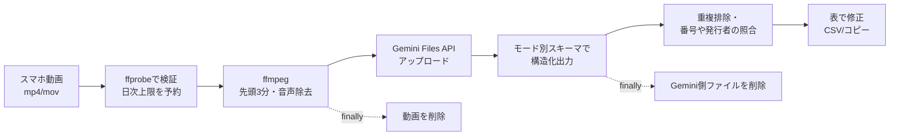

## 作ったもの

スマホで撮った動画（最長3分）をアップロードすると、映っている**領収書・名刺を読み取って表とCSVにする Web アプリ**を作りました。身内数人で試すためのプロトタイプです。

1枚ずつ写真を撮るのではなく、書類を順番に机に置いて動画で撮るだけで済むのがポイントです。読み取る書類は、アップロード画面で3つのモードから選びます。

| モード | 用途 | 主な項目 |
|---|---|---|
| 経費精算 | 受け取った領収書・レシート | 日付、勘定科目（候補）、支払先、金額、インボイス登録番号 |
| 売上管理 | 自分が発行した領収書 | 発行日、宛名、税込・税抜・税額、税率、但し書き、売上区分（候補）、領収書番号、支払方法 |
| 名刺 | 名刺 | 会社名、氏名、役職、部署、住所、電話、メール |


*画面の値は mock モードの架空のサンプルです*

- リポジトリ: https://github.com/oranegewimps/video-receipt-ocr
- 技術: Python / FastAPI / google-genai（Gemini API）/ ffmpeg / 素の HTML・JS / pytest + GitHub Actions

実装は Claude Code と一緒に進めました。私が要件（特に削除・コスト・課金の扱い）を書いて計画を承認し、課金が発生する操作はすべて私の指示で実行する、という分担です。AI はドキュメントと SDK の調査、実装、テストを担当しました。

## 全体の流れ



アップロードを受けたらジョブIDを返し、解析はバックグラウンドで進めます。画面はステータスをポーリングし、完了したら表を表示します。

## 設計で工夫した点

### 1. モデル呼び出しを1つの関数に閉じ込め、mock を最初から用意する

モデルを呼ぶ処理は `extract(video_path, mode) -> dict` だけに閉じ込めました。`GEMINI_MODE=mock` のときは外部通信をせず、モードごとの固定サンプルを返します。

```python
def extract(video_path, mode="expense", *, settings=None, model=None) -> dict:
    if mode not in MODES:
        raise ValueError(f"unknown mode: {mode}")
    settings = settings or load_settings()
    if settings.is_live:
        return _extract_gemini(Path(video_path), mode, settings, model or settings.gemini_model)
    return _extract_mock(mode, model or settings.gemini_model)
```

mock のサンプルには「同じ書類を別のフレームで再検出した」想定のデータをわざと入れてあり、重複排除が効くことを画面でもテストでも確かめられます。画面・削除・上限といった処理はすべて mock で通してから、実 API を1回だけ呼びました。テストでは、mock の間に外部へ接続しようとしたら失敗するように、ソケットの接続も遮断しています。

### 2. 「推測させない」と「推定させたい」を分ける

帳簿に使うデータなので、読めない項目は null にしてもらいます。一方で勘定科目や売上区分は、そもそも書類に書かれていない「判断」です。そこでプロンプトのルールを次のように分けました。

```text
- 読めない項目・書類に書かれていない項目は、推測せず null にする。
- ただし account_title（勘定科目）は、業種や但し書きなどから推定してよい。
  推定した場合は、その項目名を必ず low_confidence_fields に入れる。
```

スキーマでは、すべての項目を `"type": ["string", "null"]` のように null 許容にしています。`low_confidence_fields` は、そのモードの項目名だけを選べる enum の配列です。画面では、この配列に入った項目を黄色で表示し、手で直した項目は青に変わります。

```python
props["low_confidence_fields"] = {
    "type": "array",
    "items": {"type": "string", "enum": fields(mode)},
    "description": "推定した項目、または値を入れたが読み取りに自信がない項目の名前",
}
```

### 3. 「残さない」は finally と、既定値の確認で作る

動画は、解析の成否にかかわらず `finally` で作業ディレクトリごと削除します。Gemini 側にアップロードしたファイルも、`extract()` の `finally` で消しています。

```python
uploaded = None
try:
    uploaded = client.files.upload(file=str(video_path), config={...})
    ...
    interaction = client.interactions.create(
        model=model,
        input=[video_part, {"type": "text", "text": prompt(mode, settings)}],
        response_format={"type": "text", "mime_type": "application/json",
                         "schema": response_schema(mode)},
        store=False,  # 既定は True（サーバ側に保存）なので必ず無効にする
    )
finally:
    if uploaded is not None:
        delete_gemini_file(client, uploaded.name)
```

ここで一番効いたのは、**SDK のソースを読んで既定値を確認したこと**です。公式ドキュメントの動画・構造化出力の例は Interactions API（`client.interactions.create`）に移っていました。そこで google-genai 2.34.0 のソースを読むと、このAPIはリクエストと応答を**既定でサーバ側に保存する（`store=True`）**ことがわかりました。動画を消しても、ここが有効なままでは「残さない」になりません。

削除できていることは、ログ以外の方法でも確かめました。解析中は作業ディレクトリに `input.mp4` と `prepared.mp4` があり、完了後は空になります。Gemini 側も、Files API の一覧で残っていないことを確認するスクリプトを用意しました。

### 4. 日次上限は「受け付けた時点」で数える

APIの費用は、失敗した呼び出しでも発生しえます。そのため、日次の回数上限は解析の成功ではなく、**動画を検証して受け付けた時点**で1回と数えるようにしました。SQLite への追加と上限の判定は、同じロックの中で行います。

```python
def try_reserve(self, job_id, user_label, limit_user, limit_total, size_bytes, duration_sec, mode):
    with self._lock, self._conn:
        reason = self._reason(*self._counts(today(), user_label), limit_user, limit_total)
        if reason:
            return reason
        self._conn.execute("INSERT INTO jobs(...) VALUES (...)", (...))
    return None
```

壊れたファイルなど、APIを呼ぶ前に弾いたものは数えません。

### 5. 売上管理モードの発行者は「読まない」

途中で前提が変わりました。テストに使っていた領収書は、私が**発行した側**のものだったのです。発行した領収書なら、発行者は自分です。そこで売上管理モードでは、発行者名・登録番号・住所を設定値（`.env`）から入れ、動画からは読まないことにしました。

それでも、動画に写った発行者名や登録番号は照合用にだけ読ませています。設定値と食い違えば「要確認」にするので、他人の領収書が紛れ込んでいれば気づけます。あわせて、税抜＋税額が税込と合わない場合も、金額3項目を要確認にしています。

```python
if seen_name and settings.self_name:
    a, b = _norm(seen_name), _norm(settings.self_name)
    if a not in b and b not in a:  # 「見本商店」と「見本商店 本店」のような部分一致は許容
        mismatch = True
        _flag(d, "issuer_name_in_video")
```

## 費用の実測

8.6秒・480×854 のテスト動画1本を `gemini-3.8-flash` で解析した結果です。音声は ffmpeg で除去してから送っています。

| 項目 | 値 |
|---|---|
| 所要時間 | 15.0秒（アップロード・待機・解析・削除を含む） |
| 入力トークン | 950（動画1分あたり約6,700） |
| 出力トークン | 363 |
| 概算費用 | $0.0021（約0.3円） |

単純に伸ばすと、3分の動画で入力は約2万トークン、1本2〜3円程度の見込みです。単価は変わるので、コードには埋め込まず環境変数で持たせています（このモデルは 2027年1月から値上げが予告されています）。2モデルを比べる評価スクリプトも付けましたが、実測はまだ数本だけです。

## 振り返り

- **課金のある操作は人が開ける**：AI には「実行してよい」と言われるまで実 API を呼ばせず、呼ぶときも「1本・1モデル・再試行なし」と範囲を指定しました。おかげで、開発中に実 API を呼んだのは4回だけで、実費は合計約$0.008（約1円）でした。
- **ドキュメントだけで判断しない**：`store=True` が既定であることは、ドキュメントの例を読むだけでは気づきにくい点でした。SDK のソースまで確認したのは、AI 側の判断です。
- **前提が変わっても局所的に直せた**：モードの追加は、`extract()` の引数とスキーマ定義、画面の列定義を増やすだけで済みました。モデル呼び出しを1か所に閉じ込めておいた効果です。

## 既知の課題

- 実 API での確認は短いテスト動画数本だけで、精度はまだ測れていません。
- ジョブはメモリで管理しているので、プロセス1つで動かす前提です。
- 3分での切り詰めは再エンコードしないため、1秒ほどはみ出すことがあります。
- Cloud Run へのデプロイ（署名付きURLでの直接アップロード、Secret Manager）は未着手です。
- 国税庁 Web-API による登録番号の照合は実装しましたが、アプリケーションIDがないため未確認です。

